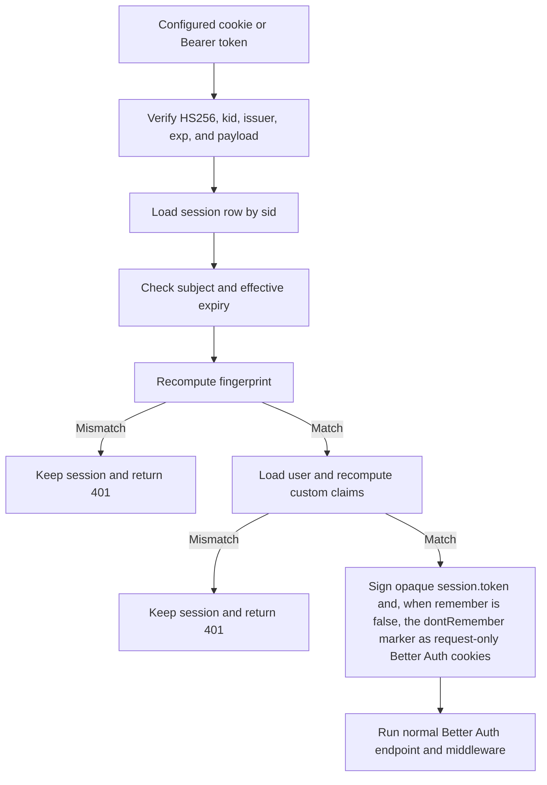

# Native Session-Centric JWT architecture

A Session-Centric JWT is a signed client transport for a server-side session, not a stateless replacement for one. `better-auth-scjwt` signs the Better Auth session-row ID and device constraints into a JWT while preserving Better Auth's database as the only authorization source of truth.

## Why retain a session row?

A purely stateless access token remains usable until its cryptographic expiry unless the application adds a revocation list. A canonical session row provides immediate revocation through the same operations Better Auth already uses for sign-out, password security, administration, and user deletion.

SCJWT intentionally performs a database read for each presented token. The JWT protects the pointer and selected claims from tampering; it does not remove the authoritative lookup.

| Property | Stateless JWT | Opaque database session | SCJWT |
|---|---|---|---|
| Client-verifiable structure | Yes | No | Yes |
| Immediate revocation | Requires extra state | Yes | Yes |
| Authoritative lookup per request | No | Yes | Yes |
| Device binding in credential | Optional | External | Built in |
| Better Auth native endpoint compatibility | Separate integration | Native | Native after verified request-cookie injection |

## Request flow

The injected cookies never replace the response transport. They exist only in the current request headers so Better Auth's native `getSession`, sensitive-session middleware, account endpoints, and third-party plugins follow their standard path. A caller-supplied `dontRemember` cookie is always discarded; the marker comes only from the signed `remember` claim. Cookie-cache `session_data` cookies (including chunks) are removed from the same request, so a client-held snapshot can never replace the session and user that `internalAdapter.findSession` just returned, even when `session.cookieCache` is enabled.

## Issuance and refresh flow

Better Auth's `setSessionCookie` records `ctx.context.newSession`. SCJWT issues from that value in a session finalizer: `scjwt()`'s `init` appends an internal plugin, `scjwt-session-finalizer`, after every registered plugin, and its after hook runs once all other plugin after-hooks have finished. It therefore observes the final result and the final `newSession`: a later hook that rejects the request, withdraws the session (for example a pending two-factor challenge), or substitutes another session determines what is issued. No endpoint names are assumed, so OAuth callbacks, magic links, passkeys, impersonation, and custom plugins receive the same behavior as email/password routes, for both HTTP requests and direct `auth.api` calls.

The finalizer position relies on Better Auth 1.7.18 appending `init`-returned plugins and running plugin after-hooks in order. Before every endpoint, SCJWT verifies that no plugin with after-hooks follows the finalizer (for example one appended by another plugin's `init`) and fails the request with `[scjwt] session finalizer must run after all plugin after-hooks.` rather than issuing early. Registering `scjwt()` more than once fails initialization.

Better Auth `session.expiresIn` caps token lifetime. Better Auth `session.updateAge` controls refresh. A native refresh sets `newSession`, and the finalizer emits a replacement SCJWT only for a successful result: any status below 400, including `ctx.redirect` and returned 3xx `Response` redirects. A failed result (status 400 or higher), a session that has already expired, or a token that cannot be signed (for example invalid custom claims) expires the native session cookies accumulated by the request and drops any pending `set-auth-token`, so the opaque native token never stands in for an SCJWT. The backing session row is left to Better Auth.

## Transport behavior

### Cookie

- Reads only `ctx.context.authCookies.sessionToken.name`.
- Replaces only a live native session-token response cookie.
- Preserves Better Auth's exact resolved name, secure prefix, path, domain, SameSite, HttpOnly, expiry, and partitioned attributes.
- Preserves session-data, account-data, and clear-cookie entries.

### Header

- Reads only `Authorization: Bearer`.
- Emits `set-auth-token` and exposes it through CORS exactly once.
- Removes live session-token, session-data, and `dontRemember` cookies.
- Preserves account-data and clear-cookie entries.
- Requires the client to delete stored Bearer state after logout or revocation.

Transport selection also defines precedence. The unselected source is ignored rather than used as a fallback.

"Live" follows RFC 6265 §5.3: an empty value, a zero or negative `Max-Age`, or (when `Max-Age` is absent) a past `Expires` marks a clearing cookie, and `Max-Age` wins over `Expires` when both are present. When a response sets the same cookie more than once, the last entry decides, which is also how the `remember` claim reads Better Auth's `dontRemember` marker.

## Claims

Core claims are `iss`, `sub`, `fp`, `iat`, `exp`, `sid`, and `remember`. `remember` is `false` exactly when the issuing response carried a live Better Auth `dontRemember` marker (a `rememberMe: false` sign-in or a re-issuance that inherited it), and it is required: tokens without it are rejected. `getCustomClaims` may add bounded JSON values. The resolver receives the authoritative session and user plus the current `Request` when one exists.

Custom claims are visible signed data, not encrypted profile storage. The implementation limits count, encoded size, nesting, types, and reserved names. Verification reruns the resolver and requires JSON equality: structural, independent of object key order, and by numeric value, so a value JSON normalizes during signing (such as `-0`) still matches its resolver output. This turns current roles or entitlements into short-lived assertions without creating a second revocation database.

## Fingerprints and proxies

`strict` mode hashes Better Auth's resolved IP, User-Agent, and `Sec-CH-UA-Platform`. `ip-only` hashes the same IP with canonical empty browser fields. Missing optional browser headers are therefore deterministic.

IP selection is delegated to Better Auth's `advanced.ipAddress.ipAddressHeaders`, `trustedProxies`, and `ipv6Subnet`. Keeping one resolver avoids divergent rate-limit, session-tracking, and SCJWT identities.

## Storage invariant

SCJWT must be able to resolve and delete a canonical database row immediately. Initialization rejects:

- configurations without a Better Auth database;
- `secondaryStorage` configurations unless `session.storeSessionInDatabase: true`.

This is deliberate. A secondary-store-only cache cannot satisfy the plugin's database-backed revocation contract.

## Key rotation

Plain Better Auth `secret` produces an HS256 token without `kid`. Better Auth versioned `secrets` produces a token with the current version in `kid`. Verification selects that exact retained version, allowing rotation without accepting unknown key IDs.

## Verification inventory

- `test/native-session.test.ts`: cookie/header transport, native `getSession`, custom secure prefixes, precedence, callback issuance, failure suppression, core sign-out.
- `test/custom-claims.test.ts`: issuance/refresh resolver calls (exactly one per issuance and verification), JSON limits at their exact boundaries (16/17 keys, 1024/1025 UTF-8 bytes including multi-byte text, 8/9 nested containers), cycles versus repeated references, reserved names, prototype-named keys, JSON numeric equality, strict default payload, dynamic mismatch, secret rotation.
- `test/jwt-security.test.ts`: endpoint-level rejection of tampered signatures and payloads, foreign secrets and issuers, expired and exact-expiry tokens, `alg: none` and HS384, each missing core claim, wrong claim types and fractional timestamps, malformed fingerprints, foreign subjects, unknown sessions, and expiries beyond the stored session or configured lifetime; versioned-secret rotation with retained, removed, unknown, missing, malformed, and non-string `kid`, and plain secrets rejecting any `kid`. Every rejection is the same generic `401` with no issued credential, and the valid control session survives. Cases follow [RFC 8725](https://www.rfc-editor.org/rfc/rfc8725.html) algorithm, issuer/subject, and claim-validation practices; they are boundary checks, not a security certification.
- `test/lifecycle-finalization.test.ts`: terminal finalizer ordering, late denial and session withdrawal or substitution, HTTP and direct `auth.api` parity, shared plugin instances, finalizer-position and duplicate-registration guards.
- `test/session-lifetime.test.ts`: `rememberMe: false` sessions in both placements keep their native expiry without sliding, remembered sessions refresh, supplied `dontRemember` cookies are ignored, re-issuance inherits the policy, and a remembered sign-in replaces a non-persistent session.
- `test/session-cache.test.ts`: compact/jwt/jwe and chunked `session_data` snapshots never override current session and user data, revoked sessions stay rejected, foreign snapshots cannot change the authenticated user, header placement ignores native caches, and refresh plus the non-persistent policy still apply.
- `test/fingerprint-mode.test.ts`: missing headers, strict mismatch revocation, IP-only behavior, trusted proxies.
- `test/secondary-storage.test.ts`: database and secondary-storage initialization invariants.
- `test/token-delivery.test.ts`: cookie lifetime precedence (`Max-Age` over `Expires`, non-positive `Max-Age`, empty values) for replacement and removal in both placements, last-entry liveness, and preservation of unrelated and account cookies.
- `test/admin-revoke-paths.test.ts`: Better Auth admin ban and session-revoke paths.
- [`REVOKE_AUDIT.md`](./REVOKE_AUDIT.md): Better Auth 1.7.6 deletion-path audit.
